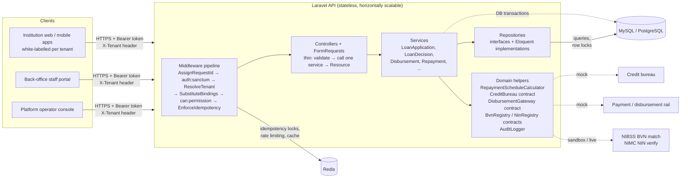
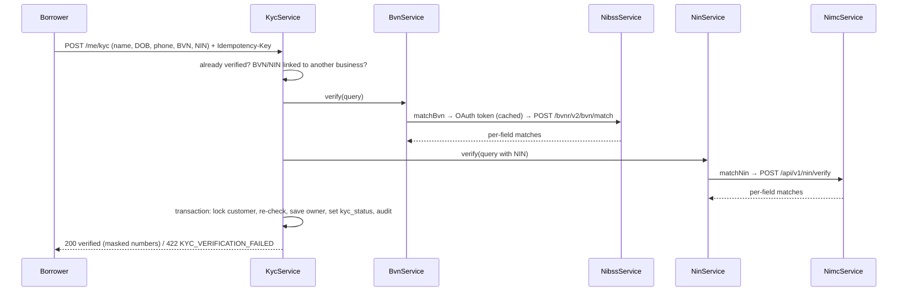
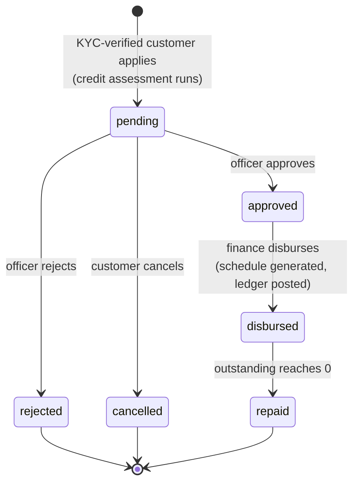
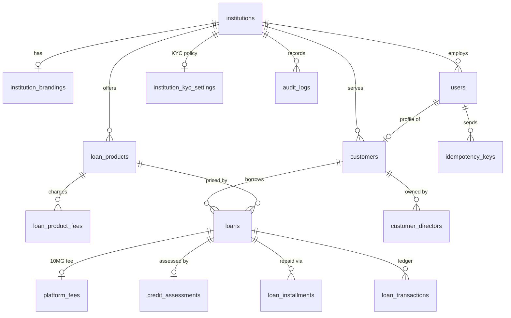

# 10MG V2 Lending Core — Architecture & Database Design

A simplified multi-tenant lending backend for healthcare credit. One shared deployment runs many lenders (tenants), and each
one gets its own branding, loan products, pricing and staff. The borrowers are **healthcare businesses** (pharmacies, patent
medicine stores, clinics, hospitals, laboratories, diagnostic centres). They apply for inventory, equipment or emergency
financing; the platform verifies the owner's identity (BVN with NIBSS, NIN with NIMC), scores the business profile
instantly, then approves, disburses and tracks repayments.

---

## 1. High-level architecture



**Style:** a modular monolith in Laravel. Controllers stay thin and the business rules sit in
**services**, which reach the database only through **repositories**, so rules can be tested and called from
HTTP, queues or the CLI. External integrations (credit bureau, disbursement rail, identity registers)
are **interfaces bound in the service container**. The credit bureau and disbursement rail have mock implementations;
the NIBSS and NIMC clients make real HTTP calls in `live` mode and answer locally in `sandbox` mode.
Swapping in a real provider is a binding or configuration change, not a code change.

### Target AWS deployment (not provisioned here; documented intent)

| Concern | AWS service |
|---|---|
| API compute | ECS Fargate (or Lambda via Bref) behind an ALB |
| Database | RDS MySQL/Aurora, Multi-AZ, encrypted at rest |
| Cache / locks / queues | ElastiCache Redis; SQS for async jobs |
| Secrets | Secrets Manager / SSM Parameter Store |
| Logs / audit export | CloudWatch Logs → S3 (Object Lock) for immutable audit archive |
| Edge | CloudFront + WAF; per-tenant custom domains via ACM |

---

## 2. Multi-tenancy model

**Strategy: shared database, shared schema, row-level isolation via `institution_id`.**

| Option | Isolation | Ops cost | Chosen? |
|---|---|---|---|
| DB per tenant | Strongest | High (migrations × N, connections) | No |
| Schema per tenant | Strong | Medium (not portable to MySQL) | No |
| **Shared schema + `institution_id`** | Enforced in app + DB FKs/indexes | Low, scales to many small tenants | **Yes** |

This suits a white-label platform with many small or medium institutions. A large
tenant can later be moved to a dedicated DB, because every query already goes through one
tenancy layer.

### How isolation is enforced (defense in depth)

1. **Tenant resolution:** the `ResolveTenant` middleware sets a request-scoped `TenantContext`. It is prioritised to run before `SubstituteBindings`, so route-model binding is already scoped:
   - Authenticated tenant users get it from **`users.institution_id`**, which comes from the token and can't be spoofed.
   - Public tenant endpoints (customer sign-up, branding, product catalogue, login) get it from the **`X-Tenant: <slug>`** header.
   - If a header is sent along with a token from another tenant, the request is rejected with `403 TENANT_MISMATCH`.
2. **Global scope:** every tenant-owned model uses the `BelongsToInstitution` trait. It
   - adds `WHERE institution_id = :current` to every query, including route-model binding.
     A foreign record therefore returns **404**, so the API doesn't reveal that it exists.
   - **fails closed:** with no tenant in context the scope matches nothing. Cross-tenant system jobs
     (the overdue command) iterate institutions explicitly with `TenantContext::runAs()`.
   - fills in `institution_id` on create and **refuses to create** tenant data with no tenant context.
3. **Composite uniqueness:** business keys are unique per tenant, e.g.
   `(institution_id, email)` and `(institution_id, code)`.
4. **Ownership policies:** customers can only see their own loans. Staff see all loans in their tenant.
5. **Lifecycle gate:** `ResolveTenant` rejects pending or suspended institutions (`403 TENANT_INACTIVE`). Suspending an institution also revokes every token its users hold.

---

## 3. Authentication & RBAC

- **Laravel Sanctum** personal access tokens (stateless bearer tokens, revocable, hashed at rest).
- One `users` table for all actors. `institution_id` is `NULL` only for platform operators.
- Roles map to fine-grained **permissions** (`App\Enums\Role::permissions()`). Each permission
  is registered as a Gate, and routes declare `->can('loans.approve')`. Controllers never check roles directly.

| Permission | platform_admin | institution_admin | loan_officer | finance_officer | customer |
|---|:-:|:-:|:-:|:-:|:-:|
| institutions.manage (approve/suspend) | ✅ | | | | |
| branding.manage, kyc-settings.manage, products.manage, staff.manage | | ✅ | | | |
| audit.view | ✅ | ✅ | | | |
| platform-fees.view (10MG fees owed) | | ✅ | | ✅ | |
| loans.view (all in tenant) | | ✅ | ✅ | ✅ | |
| loans.review (approve / reject) | | ✅ | ✅ | | |
| loans.disburse | | ✅ | | ✅ | |
| repayments.record (back-office) | | ✅ | | ✅ | |
| loans.apply, loans.view-own, repayments.make-own | | | | | ✅ |

Approval and disbursement are separate permissions. This gives a real **maker/checker**
separation: a loan officer approves and a finance officer releases the funds. It's also enforced **per loan**, so
an institution admin who holds both permissions still can't disburse a loan they approved themselves
(`403 SEGREGATION_OF_DUTIES`; `lending.enforce_four_eyes`). Borrowers manage their own business profile
(`/me/business`: trading figures, location, licence renewal). Legal identity (CAC number, business type) is immutable there.
Borrowers also complete their owner's identity check themselves (`/me/kyc`, section 4); staff see the resulting
`kyc` status on `GET /customers/{id}` but never the identity numbers.

---

## 4. Borrower KYC (BVN + NIN)

A borrower is a business, but BVN and NIN belong to **people**, so they are captured for the business's owner in `customer_directors`. Whether verification is required, and which checks it consists of, is **each lender's choice** (see *KYC settings* below). With the defaults, both checks must pass before the business can apply (`422 KYC_REQUIRED` otherwise).



| Layer | Class | Responsibility |
|---|---|---|
| Transport | `IdentityRegistryClient` (abstract) → `NibssService`, `NimcService` | OAuth2 client-credentials token (cached 50 min), JSON request with timeout and retry on connection errors, provider envelope `{responseCode, reference, data.fieldMatches}`. Unreachable provider → `503 IDENTITY_PROVIDER_UNAVAILABLE`. Bound to `Contracts\BvnRegistry` / `Contracts\NinRegistry` |
| Matching rules | `BvnService`, `NinService` | Number not found → fail. First name, last name and date of birth must match; a phone mismatch is recorded but tolerated (BVN phone numbers are often stale) |
| Orchestration | `KycService` | Duplicate checks, both lookups **outside** the transaction (no lock held on the network), then one transaction that persists the outcome, pass or fail, with an audit entry |

**Sandbox mode** (`NIBSS_MODE` / `NIMC_MODE` = `sandbox`, the default) builds exactly the same request but answers it locally with a full match, so the flow runs without credentials. `live` mode sends it; tests drive `live` mode through `Http::fake()` to pin the request shape.

**Protecting the numbers (NDPA 2023):** encrypted at rest (`encrypted` cast), an HMAC-SHA256 fingerprint keyed with `APP_KEY` for uniqueness, the last four digits for display, `$hidden` on the model, masked (`*******8901`) in every response and audit entry. One BVN / NIN may back only one business **per lender**; the same person can bank with two lenders.

### KYC settings (each lender's choice)

`institution_kyc_settings` holds one row per lender, managed by its admin through `GET`/`PATCH /kyc-settings` (permission `kyc-settings.manage`) and audited as `institution.kyc_settings_updated`. Platform operators see each lender's policy read-only in `GET /platform/institutions/{id}` (`kyc_settings`). A lender that never chose gets the platform defaults from `config/lending.php` (`LENDING_REQUIRE_KYC`, `LENDING_KYC_*`).

| Switch | Default | Effect |
|---|---|---|
| `kyc_required` | on | Applications are refused (`422 KYC_REQUIRED`, with `outstanding_checks`) until every enabled check has passed. Off: verification is optional and does not block applying |
| `bvn_check_enabled` | on | Match the owner's BVN with NIBSS. Off: no BVN is asked for (the field is ignored) and NIBSS is never called |
| `nin_check_enabled` | on | Match the owner's NIN with NIMC. Off: likewise for the NIN and NIMC |
| `phone_match_required` | off | A phone mismatch fails the check instead of only being recorded |

**Rules:**
- **Invalid combination refused:** requiring KYC with both checks off is refused with `422`.
- **Nothing to check:** with both checks off, `POST /me/kyc` returns `409 KYC_NOT_ENABLED` and the borrower's status is `not_required`.
- **What a business has passed is recorded:** `customers.kyc_checks` lists each check the business has passed, e.g. `["bvn"]`. Status is judged against the lender's **current** settings, so it can change when the lender changes its policy:
  - A borrower verified under a BVN-only policy shows `nin` as outstanding (`status: pending`, `can_apply: false`) once the lender switches the NIN check on. They resubmit, and every enabled check runs again with the same details, so all passed checks describe one person.
  - A check the lender later switches off keeps its earlier result.
- **The storefront tells the app what to ask for:** `GET /tenant` publishes `kyc.required_before_applying` and `kyc.checks`, so the white-label app shows only the fields the lender needs.
- **Settings affect new applications only:** loans already applied for are unaffected.

**Where BVN fits next:** credit-bureau lookups (CRC, FirstCentral) in the scorer, NIP name enquiry on the payout account before disbursement, and Global Standing Instruction / direct-debit mandates for collections.

## 5. Lending workflow (state machine)



`App\Enums\LoanStatus::canTransitionTo()` is the single source of truth. Any illegal
transition raises `InvalidLoanState` (HTTP 409).

1. **Apply:** when the lender requires KYC, only a business that has passed every check the lender runs may apply
   (`422 KYC_REQUIRED` otherwise, see section 4). The customer picks a product, amount and tenor. These are validated against the product's
   min/max limits. **Product terms are snapshotted onto the loan** (rate, method, frequency, fees),
   so later product edits never change loans that already exist.
2. **Credit assessment (mock):** `CreditBureau` contract → `MockHealthcareCreditScorer`, standing in for the AI
   business-profile model. It gives a deterministic, explainable score (300–850) based on licence validity, provider type,
   years in operation, **debt-service coverage** (net monthly cash flow ÷ new monthly repayment), revenue scale and
   existing exposure. An expired licence, coverage below 1.20x or a score under the product minimum means `decline`. A score of
   680 or more with coverage of 1.50x or more means `approve`. Anything else goes to manual `review`. It also returns the maximum amount that keeps coverage at 1.50x.
   Products can be restricted to particular provider types (`eligible_business_types`).
3. **Approve / reject:** if the bureau recommends `decline`, approving it needs an explicit `override_reason`.
4. **Disburse (mock):** `DisbursementGateway` contract → `MockDisbursementGateway`. Inside one DB
   transaction this generates the repayment schedule, posts `disbursement` and `fee` ledger entries,
   and moves the loan to `disbursed`.
5. **Repay:** a payment is allocated oldest installment first, and within an installment
   **penalty → fees → interest → principal**. Overpayment is rejected. The loan closes automatically when the outstanding balance reaches 0.
6. **Overdue handling:** the scheduled `loans:mark-overdue` command flags installments past
   `due_date + grace_period_days` and applies the product's late fee once per installment.

### Pricing maths (`RepaymentScheduleCalculator`, a pure class)

- `flat`: interest = P × annual_rate × (n / periods_per_year), split evenly across installments.
- `reducing_balance`: amortised EMI = P·r / (1 − (1+r)^−n), where r = annual_rate / periods_per_year.
  Interest each period is charged on the remaining balance.
- `periods_per_year`: weekly 52, biweekly 26, monthly 12.
- Calculations use **bcmath** at high precision, then round to minor units. Any rounding difference
  goes into the **last installment**, so the schedule always sums exactly to the totals.
- Fees: `upfront` fees are deducted from the disbursed amount. `capitalized` fees are added to the
  amount repaid and spread across installments.

### 10MG platform fee

10MG earns a fee on every disbursed loan, separate from the lender's own product fees.

| | |
|---|---|
| **Who sets it** | A platform operator, per lender: `PATCH /platform/institutions/{id}/platform-fee` with `rate_bps` (basis points of the principal, 0–1000; 0 waives it) and `bearer`. Lenders that were never set use the platform default (`PLATFORM_FEE_BPS=50`, `PLATFORM_FEE_BEARER=lender`). Audited as `institution.platform_fee_updated` |
| **Bearer `lender`** | A commission the lender owes 10MG. The borrower's quote, payout and repayments are unchanged, and borrowers never see it |
| **Bearer `borrower`** | Priced as an upfront fee named *10MG platform fee*: listed in the quote, deducted from the payout and posted to the loan ledger with the lender's other upfront fees |
| **Snapshot** | `platform_fee_bps`, `platform_fee_bearer` and `platform_fee_amount` are copied onto the loan at application, so changing a lender's terms never reprices an existing loan |
| **Revenue ledger** | At disbursement, inside the same transaction, one append-only `platform_fees` row is written (unique per loan, so a loan can never be charged twice). Operators report across lenders (`GET /platform/platform-fees`, filters `institution_id`, `from`, `to`, totals per bearer); each lender sees its own terms and fees (`GET /platform-fees`, admin and finance) |

Settlement (invoicing lenders and marking fees paid) is the natural next step.

---

## 6. Financial integrity

| Concern | Mechanism |
|---|---|
| **Money representation** | Integer **minor units** (kobo/cents) in `BIGINT` columns; rates in **basis points** (`2400` = 24.00% p.a.). No floats ever touch money. |
| **Atomicity** | Every state-changing action runs in `DB::transaction()`. A partial failure rolls back the loan, schedule, ledger and audit rows together. |
| **Concurrency** | `SELECT … FOR UPDATE` (`lockForUpdate()`) on the loan row before any status or balance change. This blocks double-disbursement and races between concurrent repayments. |
| **Idempotency (HTTP)** | `Idempotency-Key` header **required** on money-moving POSTs. A key is scoped to the user and stores a SHA-256 hash of method+path+body plus the full response. A replay returns the stored response (`Idempotent-Replayed: true`). Reusing a key with a different payload → `422`. A concurrent duplicate → `409` (Redis/cache lock). 5xx responses aren't stored, so the client can retry. |
| **Idempotency (domain)** | `loan_transactions.reference` is unique. External payment references are unique per tenant, so the same bank callback can't post twice. |
| **Immutable ledger** | `loan_transactions` is append-only (no `updated_at`; the model refuses updates and deletes). Each row records `balance_before` / `balance_after`. |
| **Audit trail** | `audit_logs` is append-only. Every privileged action records the actor, tenant, IP, user agent, `X-Request-Id`, and old/new values. |
| **Personal data (NDPA 2023)** | BVN and NIN are encrypted at rest, fingerprinted with an HMAC for uniqueness, masked in every response and audit entry, and excluded from serialisation. Provider calls happen outside DB transactions, so no row lock waits on the network. |
| **Validation** | FormRequests at the edge. Domain invariants (limits, state, overpayment) are enforced again inside the services. |
| **Errors** | A consistent JSON envelope: `{ "message", "error": { "code", "details" } }`. Domain exceptions map to stable machine-readable codes. |

---

### Race conditions

Every race below was reproduced with real parallel requests against MySQL 8.4 and a 12-worker server (`scripts/probe.sh`), and each has a PHPUnit regression test.

| Race | Guard | Observed under contention |
|---|---|---|
| Concurrent repayments overdrawing a loan | `SELECT … FOR UPDATE` on the loan row, then the overpayment check | 12 payments where only 4 fit: 4 accepted, 8 refused (`422`); balance, schedule and ledger exact |
| Same payment retried in parallel | Atomic cache lock per `(user, Idempotency-Key)` plus a unique `(user_id, idempotency_key)` index | 10 retries of one key: one payment applied; the rest replayed or told to retry (`409`) |
| Same provider reference on two requests | Check under the loan lock, plus a unique `(institution_id, external_reference)` index (a violation becomes `409`) | Only one payment ever posted |
| Two officers approving at once | Loan row lock + state machine | 1 approval, 9 × `409 INVALID_LOAN_STATE`, one audit entry |
| Two finance officers disbursing at once | Loan row lock + state machine | Money paid out once; one schedule |
| Parallel applications exceeding the open-loan limit | Borrower (customer) row lock around count-then-insert | 8 at once with limit 3: exactly 3 accepted |
| Two overdue jobs, plus repayments, at once | Scheduler `withoutOverlapping()->onOneServer()`; per-loan lock; already-overdue installments are skipped | Each installment penalised once; balances consistent |
| Concurrent sign-ups, registrations, product codes, staff emails, custom domains | Unique indexes are the source of truth. `ApiErrorRenderer` turns the losing insert's `UniqueConstraintViolationException` into the same `422 VALIDATION_FAILED` a sequential duplicate gets (non-client-facing columns become `409 DUPLICATE_RESOURCE`); no SQL leaks | 8 identical requests: 1 × `201`, 7 × `422`, exactly one row |
| Same borrower submitting KYC twice at once | Post-lock re-check of `kyc_status` inside the transaction, plus **unique(customer_id, role)** | 8 at once: 1 × `200`, 7 × `409 KYC_ALREADY_VERIFIED`, one owner row |
| Two businesses submitting the same BVN at once | **unique(institution_id, bvn_hash)** / `nin_hash`; the renderer maps the violation to `422` on `bvn` / `nin` | Loser rolls back, stays `pending` |
| Profile update during a credit assessment | Both lock the borrower row, so scoring sees either the old or the new figures, never a mix | n/a |

**Lock ordering** is the same everywhere (loan row → its installments, or borrower row → new loan), so these paths can't deadlock each other.

**Known, accepted windows:**
- **Product edits are last-write-wins.** Two admins editing the same product at once are not locked. This is configuration, not money, every change is audited, and existing loans are protected by their snapshot.
- **A request that crashes mid-flight leaves its idempotency key in `processing`.** Retries get `409` until the key expires (24 h) instead of risking a double execution.
- **Disbursement holds the loan lock while calling the payment rail.** This is fine for a mock. A real rail should use a `disbursing` state, an outbox and a webhook callback.

## 7. Database design



Primary keys are **ULIDs**. They are sortable and can't be guessed, so the API doesn't leak record counts between tenants. Money columns are `BIGINT` minor units.

### institutions
| column | type | notes |
|---|---|---|
| id | ULID PK | |
| name | varchar | |
| slug | varchar **unique** | tenant identifier for `X-Tenant` |
| email, phone | varchar | |
| country_code | char(2) | |
| currency | char(3) | default `NGN` |
| status | enum `pending/active/suspended` | idx |
| approved_at, suspended_at | timestamp null | |
| timestamps, deleted_at | | soft delete |

### institution_kyc_settings (1:1)
`id`, `institution_id` **unique FK**, `kyc_required`, `bvn_check_enabled`, `nin_check_enabled` (default true),
`phone_match_required` (default false), `timestamps`. Created with defaults on lender registration (and backfilled for existing lenders).

### institution_brandings (1:1)
`id`, `institution_id` **unique FK**, `display_name`, `logo_url`, `primary_color`, `secondary_color`,
`support_email`, `support_phone`, `website_url`, `custom_domain` (**unique**), `timestamps`.

### users
| column | type | notes |
|---|---|---|
| id | ULID PK | |
| institution_id | ULID FK null | NULL = platform operator |
| name, email, password | | password bcrypt |
| role | enum | `platform_admin, institution_admin, loan_officer, finance_officer, customer` |
| is_active | bool | |
| last_login_at | timestamp | |
| | **unique(institution_id, email)** | the same person can bank with two tenants |

### customers (borrowing healthcare businesses)
`id`, `institution_id` FK, `user_id` FK **unique** (owner / primary contact login), `business_name`,
`business_type` enum(`pharmacy, patent_medicine_store, clinic, hospital, laboratory, diagnostic_centre`),
`registration_number` (CAC RC/BN), `licence_number`, `licence_expires_at`, `year_established`, `phone`, `address`, `city`,
`state`, `staff_count`, `monthly_revenue`, `monthly_expenses` (minor units), `timestamps`.
`kyc_status` enum(`pending, verified, failed`) (outcome of the latest attempt), `kyc_checks` json (checks passed, e.g. `["bvn","nin"]`), `kyc_verified_at`.
**unique(institution_id, registration_number)**, **unique(institution_id, phone)**, index (institution_id, business_type).

### customer_directors (owner identity for KYC)
| column | type | notes |
|---|---|---|
| id | ULID PK | |
| institution_id, customer_id | ULID FK | |
| role | enum `owner/director` | **unique(customer_id, role)** |
| first_name, middle_name, last_name, date_of_birth, phone | | as submitted, matched against NIBSS / NIMC |
| bvn, nin | text null | **encrypted** (AES-256 via `APP_KEY`), never serialised; null when the lender does not run that check |
| bvn_hash, nin_hash | char(64) | HMAC-SHA256; **unique(institution_id, bvn_hash)**, **unique(institution_id, nin_hash)** |
| bvn_last4, nin_last4 | char(4) | for masked display |
| bvn_reference, nin_reference | varchar | provider lookup references |
| bvn_verified_at, nin_verified_at | timestamp null | |
| verification_checks | json | per-field matches and failure reasons from the last attempt |

### loan_products
| column | type | notes |
|---|---|---|
| id | ULID PK | |
| institution_id | FK | idx |
| name, code, description | | **unique(institution_id, code)** |
| currency | char(3) | |
| min_amount, max_amount | bigint | minor units |
| min_tenor, max_tenor | smallint | number of installments |
| interest_rate_bps | int | annual rate |
| interest_method | enum `flat/reducing_balance` | |
| repayment_frequency | enum `weekly/biweekly/monthly` | |
| grace_period_days | smallint | before an installment becomes overdue |
| late_fee_type, late_fee_value | enum `fixed/percentage`, int | % in bps of installment due |
| min_credit_score | smallint null | |
| eligible_business_types | json null | restrict to provider types; null = all |
| is_active | bool | |
| timestamps, deleted_at | | |

### loan_product_fees
`id`, `institution_id`, `loan_product_id` FK, `name`, `calculation` enum(`fixed, percentage`),
`value` (minor units or bps), `charge_type` enum(`upfront, capitalized`), `timestamps`.

### loans
| column | type | notes |
|---|---|---|
| id | ULID PK | |
| institution_id, customer_id, loan_product_id | FK | idx (institution_id, status) |
| reference | varchar **unique** | human-readable, e.g. `LN-20261105-7KQ2M9` |
| status | enum | see state machine |
| currency | char(3) | |
| principal_amount | bigint | requested and approved principal |
| tenor | smallint | installments |
| interest_rate_bps, interest_method, repayment_frequency | | **snapshot of product terms** |
| fees_snapshot | json | the product's fees at the time of application |
| grace_period_days, late_fee_type, late_fee_value | | snapshot of overdue rules |
| penalty_fees | bigint | late fees charged so far |
| total_interest, upfront_fees, capitalized_fees | bigint | |
| net_disbursement_amount | bigint | principal − upfront fees |
| platform_fee_bps, platform_fee_bearer, platform_fee_amount | int, enum `lender/borrower`, bigint | 10MG fee terms locked in at application |
| total_repayable | bigint | principal + interest + capitalized fees (+ late fees) |
| amount_paid, outstanding_balance | bigint | maintained under row lock |
| purpose | enum `inventory_restock, medical_equipment, working_capital, emergency_financing, facility_expansion, other` | |
| purpose_note | varchar null | |
| reviewed_by, reviewed_at, decision_reason | | approve/reject |
| disbursed_by, disbursed_at, disbursement_reference | | |
| first_due_date, maturity_date, closed_at | date / ts | |
| timestamps | | |

### credit_assessments
`id`, `institution_id`, `loan_id` FK **unique**, `provider`, `score`, `risk_grade` (A–E),
`recommendation` enum(`approve, review, decline`), `debt_service_coverage_bps` (15000 = 1.50x), `net_monthly_cash_flow`,
`max_recommended_amount`, `factors` json, `assessed_at`.

### loan_installments (the repayment schedule)
`id`, `institution_id`, `loan_id` FK, `sequence` (**unique with loan_id**), `due_date`,
`principal_due`, `interest_due`, `fee_due`, `penalty_due`, `total_due`,
`principal_paid`, `interest_paid`, `fee_paid`, `penalty_paid`, `amount_paid`,
`status` enum(`pending, partially_paid, paid, overdue`), `paid_at`, `timestamps`. Index `(status, due_date)`.

### loan_transactions (append-only ledger)
`id`, `institution_id`, `loan_id` FK, `type` enum(`disbursement, fee, repayment, penalty`),
`amount`, `reference` **unique**, `external_reference` (**unique with institution_id**, nullable),
`channel`, `balance_before`, `balance_after`, `allocation` json, `performed_by`, `meta` json, `created_at`.

### audit_logs (append-only)
`id` bigint, `institution_id` null, `user_id` null, `action` (e.g. `loan.approved`),
`auditable_type`, `auditable_id`, `old_values` json, `new_values` json, `ip_address`,
`user_agent`, `request_id`, `created_at`. Index `(institution_id, created_at)`, `(auditable_type, auditable_id)`.

### platform_fees (append-only)
`id`, `institution_id` FK, `loan_id` FK **unique**, `bearer` enum(`lender, borrower`), `rate_bps`, `base_amount` (principal),
`amount`, `currency`, `accrued_at`, `created_at`. Index `(institution_id, accrued_at)`, `(accrued_at)`. The model refuses updates and deletes.
`institutions` also carries `platform_fee_bps` and `platform_fee_bearer` (NULL = platform default).

### idempotency_keys
`id`, `user_id`, `idempotency_key`, `request_method`, `request_path`, `request_hash`,
`status` enum(`processing, completed`), `response_status`, `response_body` longtext,
`expires_at`, `timestamps`. **unique(user_id, idempotency_key)**. Rows expire after 24 h (`model:prune`).

---

## 8. Code layout

```
app/
├── Http/
│   ├── Controllers/Api/V1/  thin: FormRequest in → one service call → Resource out
│   ├── Middleware/          AssignRequestId, ResolveTenant, EnforceIdempotency
│   ├── Requests/            all validation, including list filters
│   └── Resources/           JSON transformers
├── Services/                business rules, transactions, auditing
│   ├── AuthService, InstitutionService, BrandingService, StaffService,
│   │   CustomerService, KycService, KycSettingsService, PlatformFeeService, LoanProductService, AuditLogService, AuditLogger
│   ├── Identity/            NibssService, NimcService (HTTP clients), BvnService, NinService (matching rules)
│   ├── Loans/               LoanApplicationService, LoanPricingService, LoanDecisionService,
│   │                        DisbursementService, RepaymentService, OverdueService, LoanService (reads)
│   ├── Lending/             RepaymentScheduleCalculator (pure pricing engine)
│   ├── Credit/              MockHealthcareCreditScorer (implements Contracts\CreditBureau)
│   └── Disbursement/        MockDisbursementGateway (implements Contracts\DisbursementGateway)
├── Repositories/            all data access and row locking
│   ├── Contracts/           13 interfaces (Institution, Branding, KycSettings, User, Customer, CustomerDirector, LoanProduct, PlatformFee,
│   │                        Loan, LoanInstallment, LoanTransaction, AuditLog, IdempotencyKey)
│   └── Eloquent/            implementations, bound in RepositoryServiceProvider
├── Models/                  Eloquent models (tenant-owned ones use BelongsToInstitution)
├── Policies/                LoanPolicy
├── Enums/                   Role, Permission, LoanStatus, BusinessType, LoanPurpose, …
├── Exceptions/              Api\* error types + ApiErrorRenderer
├── Console/Commands/        loans:mark-overdue (delegates to OverdueService)
└── Support/                 Tenancy (TenantContext, InstitutionScope, BelongsToInstitution), OpenApi
```

## 9. Testing strategy

- **Unit:** schedule maths (flat and reducing, rounding sums exactly), credit scoring rules, state machine.
- **Feature (HTTP, SQLite in-memory):** institution registration and approval, auth, RBAC matrix,
  tenant isolation (cross-tenant reads return 404, header spoofing returns 403), white-label config, the full loan lifecycle,
  repayment allocation and closure, overpayment, idempotent replay and payload mismatch, audit entries, overdue command,
  KYC (gate before applying, masking and encryption, NIBSS/NIMC mismatch and retry, provider outage, one BVN per business),
  lender KYC settings (defaults, BVN-only never calls NIMC, re-enabling a check, KYC off, phone matching, per-lender isolation, admin-only, audited),
  10MG platform fee (lender- vs borrower-borne pricing, terms locked at application, waived fee, operator-only and audited, revenue per lender, append-only).
- **Integration contracts:** `IdentityRegistryClientTest` runs the NIBSS and NIMC clients in `live` mode against `Http::fake()`
  to pin endpoints, OAuth token caching, headers and payloads, and the `503` path when a provider is unreachable.
- **Races:** `UniqueConstraintRaceTest` reproduces concurrent duplicates deterministically, including two businesses
  racing on one BVN and a KYC submission that loses to a concurrent one.
- **Live checks:** `scripts/probe.sh` (151 checks, real parallel requests against MySQL) and `scripts/demo.sh`.
